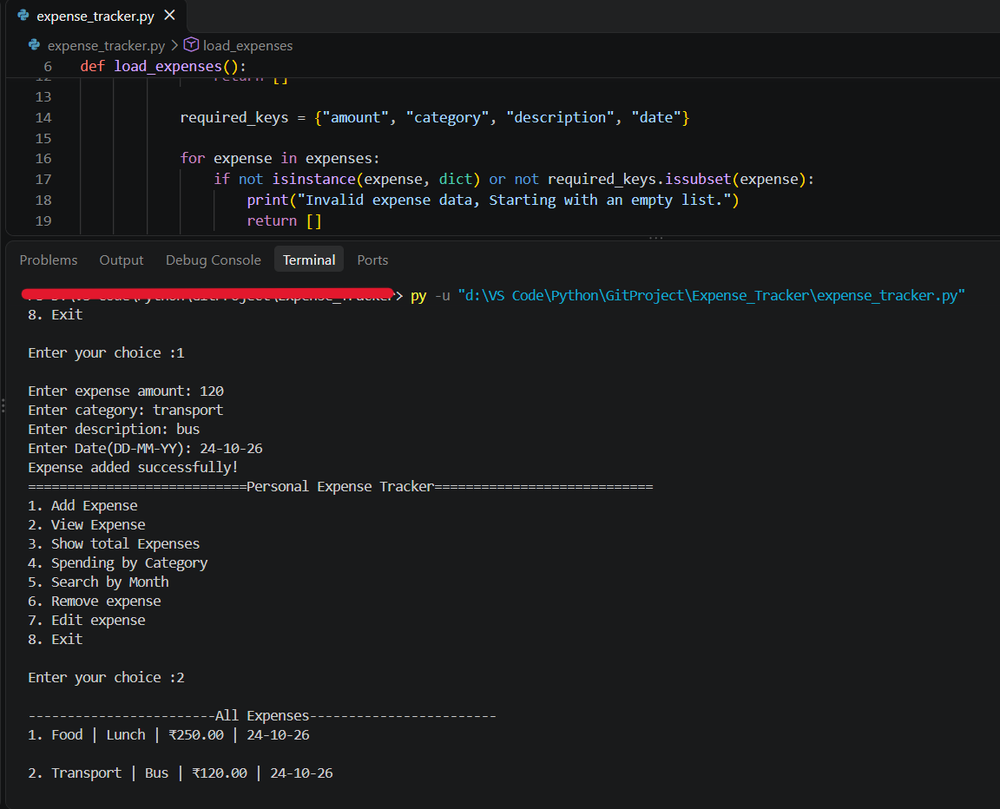

# Personal Expense Tracker

A beginner-friendly Python project for recording, managing, and analyzing personal expenses using JSON file storage. This project helped me practise core Python concepts while building a useful command-line application.

## Features

- **Add Expenses:** Record the amount, category, description, and date.
- **View Expenses:** Display all recorded expenses.
- **Total Expenses:** Calculate total spending.
- **Spending by Category:** See how much you've spent in each category.
- **Search by Month:** Find total expenses for a specific month.
- **Edit Expenses:** Update existing expense records.
- **Remove Expenses:** Delete unwanted records.
- **Input Validation:** Handle invalid amounts, dates, menu choices, and empty fields.
- **JSON Storage:** Save expense data between program runs.
- **Error Handling:** Handle missing or corrupted data files and failed save operations.
- **Colored Terminal Output:** Use ANSI escape codes to make messages and menu output easier to read.

## Technologies Used

- Python 3.10+
- JSON
- `datetime` module
- `math` module
- ANSI escape codes for terminal colors

## How to Run

1. Install Python 3.10 or newer.
2. Clone or download this repository.
3. Open a terminal in the project folder.
4. Run:

   ```bash
   python expense_tracker.py
   ```

   On some systems, you may need to use `python3` instead.

## Data Storage

The application stores expense records locally in `ExpensesData.json`. The file is created when expenses are saved.

**Note:** Personal expense data is excluded from the repository to help protect privacy.

## Screenshots



## What I Learned

- Working with Python lists and dictionaries
- Writing and organizing functions
- Validating user input
- Reading and writing JSON files
- Handling exceptions
- Implementing add, view, edit, and delete operations
- Summarizing data using loops and dictionaries
- Using ANSI escape codes to add colors to terminal output
- Using Git and GitHub to manage a project

## Future Improvements

- Add a graphical user interface
- Export expense reports to CSV
- Visualize spending with charts
- Add budget limits and alerts
- Explore SQLite for more structured data storage

---

Built as a learning project while developing my Python programming skills.
